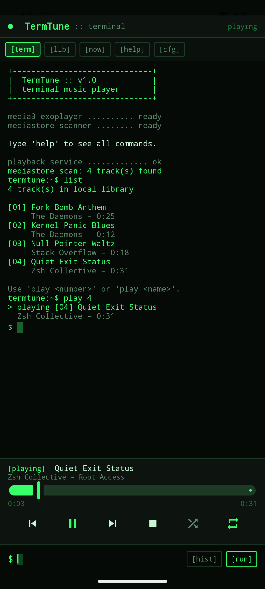
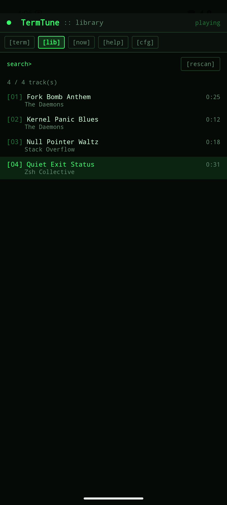
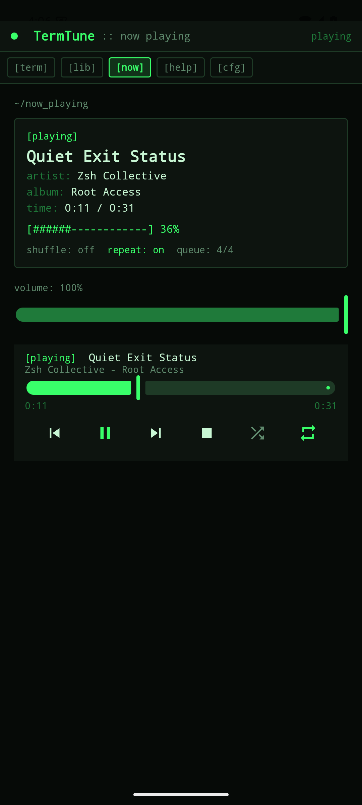
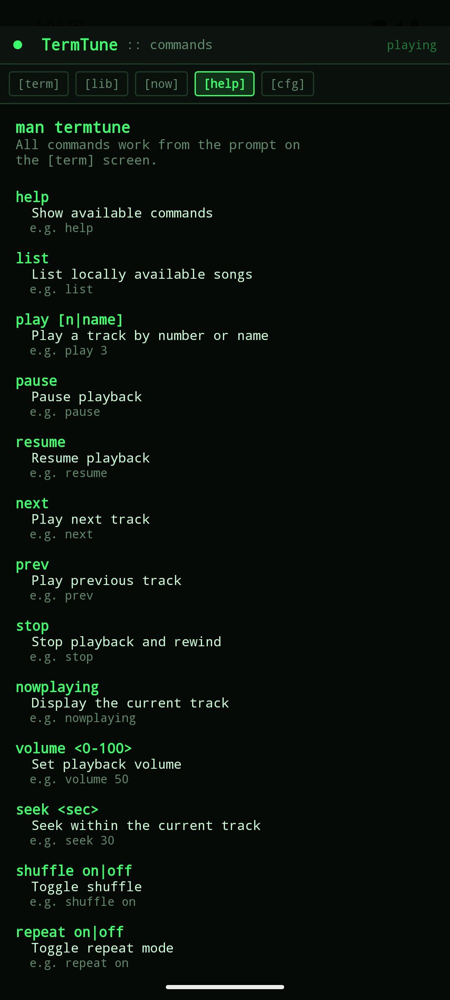
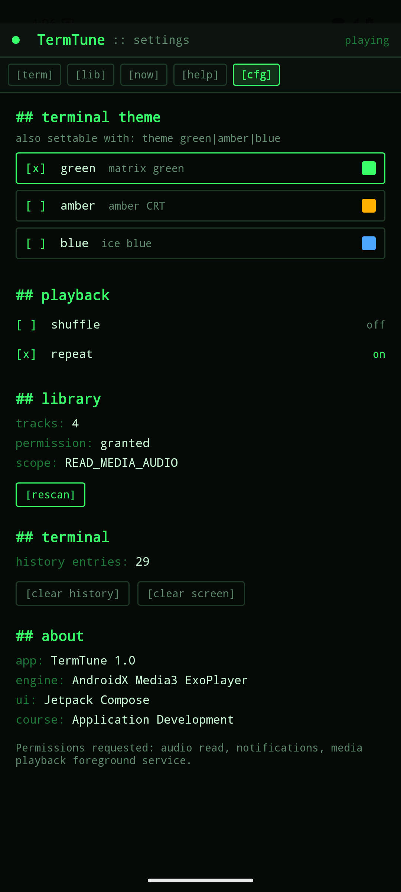
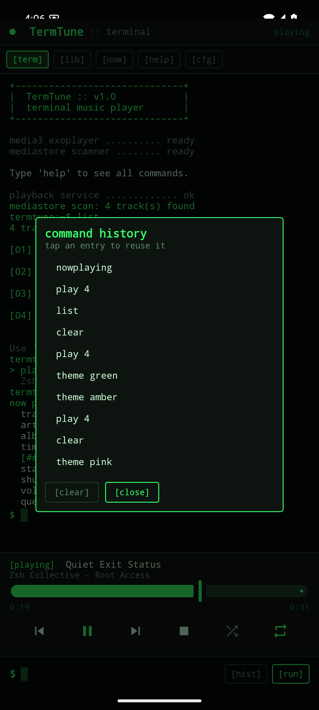
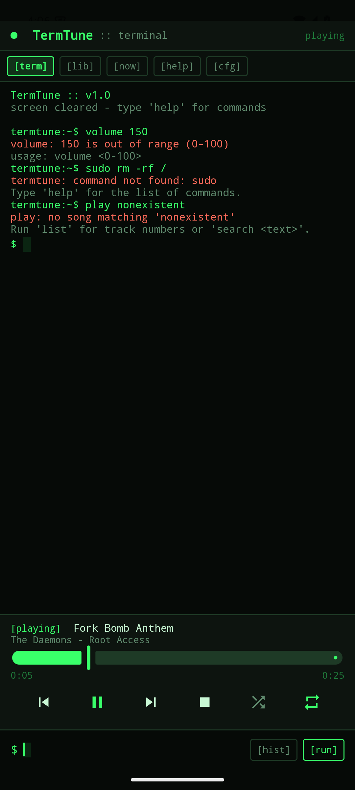
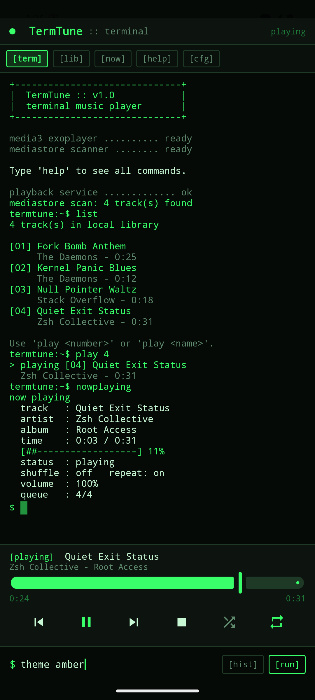
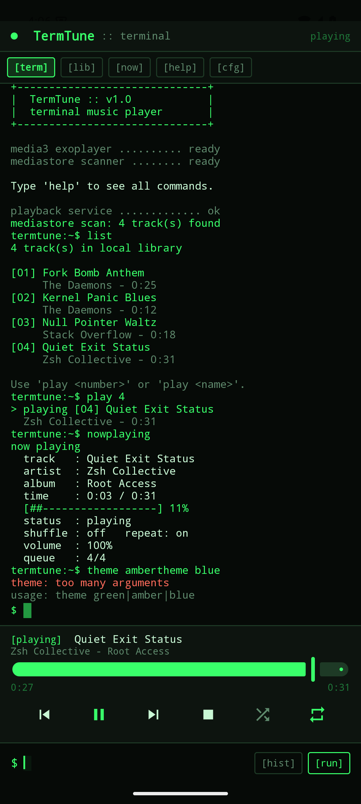
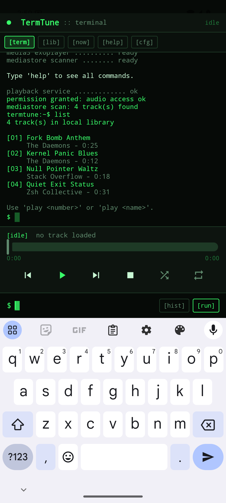

# TermTune — Terminal Music Player

A real Android music player that looks and behaves like a Linux terminal. You
type `play 3` at a prompt and a local track starts playing through ExoPlayer,
with a system media notification, background playback and audio focus handling.
Every command also has an equivalent on-screen control, and both drive the same
playback state.

Built for the **Application Development** course as an in-class project.

```
+------------------------------+
|  TermTune :: v1.0            |
|  terminal music player       |
+------------------------------+

media3 exoplayer .......... ready
mediastore scanner ........ ready

Type 'help' to see all commands.

termtune:~$ play 2
> playing [02] Null Pointer Waltz
  Stack Overflow - 0:18
```

## Problem statement

> **Terminal Music Player Application**
>
> Build a fully functional Android music player that looks and feels like a
> Linux terminal while offering a modern music-listening experience. The
> application must be a real, installable Android app with a working command
> parser, genuine local audio playback, a music library, a hybrid
> terminal-plus-player interface, command history and accessible controls.

## Features

**Terminal interface**
- Dark terminal background, monospace type throughout, coloured output lines
- A `termtune:~$` prompt with a blinking block cursor
- Scrollable command output that follows the newest line
- Three selectable themes: matrix green, amber CRT, ice blue
- Clear, specific error messages with usage hints

**Command-based control** — 16 commands, every one of them functional
- `help` `list` `play` `pause` `resume` `next` `prev` `stop` `nowplaying`
  `volume` `seek` `shuffle` `repeat` `search` `clear` `theme`
- Aliases for the muscle memory: `ls` `np` `vol` `cls` `find` `skip` `back`

**Real playback**
- Local audio discovery through MediaStore
- Runtime media permissions, handled correctly across Android versions
- AndroidX Media3 ExoPlayer inside a `MediaSessionService`
- Background playback, system media notification, audio focus and
  pause-on-headphone-unplug
- Seek, shuffle, repeat, volume, live progress, track title and artist

**Music library**
- Title, artist, album and duration for every track
- Search across title, artist and album
- Selection by track number (`play 3`) or by name (`play null pointer`)
- Scrollable listing, with the current track highlighted

**Hybrid terminal + player**
- A compact music-control area always visible under the terminal output:
  current track, play/pause, previous/next, stop, shuffle, repeat, seek bar and
  progress times
- Tapping a control runs the matching command, so the terminal logs it and the
  state can never diverge

**Command history**
- Persistent across launches, capped at 40 entries, consecutive repeats collapsed
- A `[hist]` panel to reuse any previous command (Android soft keyboards have no
  arrow keys)
- `clear` clears the screen; settings clears the stored history

**Accessibility and reliability**
- Content descriptions on every transport control, slider and tab
- `imePadding` keeps the prompt above the soft keyboard
- Distinct empty states for "no permission", "scan failed" and "no music found",
  the last with copy-paste instructions for loading test audio
- No crash when the library is empty or a command arrives before the service
  connects
- Only four permissions, all of them used

## Technology stack

| Layer | Choice |
| --- | --- |
| Language | Kotlin 2.0.21 |
| UI | Jetpack Compose (BOM 2024.10.01), Material 3 |
| Architecture | MVVM — `TerminalViewModel` over repository / player / settings |
| Playback | AndroidX Media3 ExoPlayer 1.4.1 + `MediaSessionService` |
| Library | MediaStore Audio |
| Persistence | DataStore Preferences 1.1.1 |
| Navigation | Navigation Compose 2.8.4 |
| Build | AGP 8.7.3, Gradle 8.9, JDK 17 |
| SDK | compileSdk 35, targetSdk 35, minSdk 24 (Android 7.0+) |

## Required Android permissions

| Permission | Why it is needed |
| --- | --- |
| `READ_MEDIA_AUDIO` | Read local audio via MediaStore on Android 13+ |
| `READ_EXTERNAL_STORAGE` (`maxSdkVersion="32"`) | The same, on Android 12 and below |
| `POST_NOTIFICATIONS` | Show the media playback notification on Android 13+ |
| `FOREGROUND_SERVICE` + `FOREGROUND_SERVICE_MEDIA_PLAYBACK` | Keep playing when the app is backgrounded |

No internet, location, contacts or storage-write permission is requested.

## Terminal commands

| Command | Description | Example |
| --- | --- | --- |
| `help` | Show available commands | `help` |
| `list` | List locally available songs | `list` |
| `play` | Resume, or start the library from the top | `play` |
| `play <n>` | Play a track by number | `play 3` |
| `play <name>` | Play by title or artist, exact or partial | `play null pointer` |
| `pause` | Pause playback | `pause` |
| `resume` | Resume playback | `resume` |
| `next` | Play next track | `next` |
| `prev` | Play previous track | `prev` |
| `stop` | Stop playback and rewind | `stop` |
| `nowplaying` | Show current track, progress meter and modes | `nowplaying` |
| `volume <0-100>` | Set volume | `volume 50` |
| `seek <seconds>` | Seek within the current track (also accepts `m:ss`) | `seek 30` |
| `shuffle on\|off` | Toggle shuffle | `shuffle on` |
| `repeat on\|off` | Toggle repeat | `repeat on` |
| `search <text>` | Search title, artist and album | `search daemons` |
| `clear` | Clear terminal output | `clear` |
| `theme <name>` | Switch theme: `green`, `amber`, `blue` | `theme amber` |

Invalid input is reported precisely rather than silently ignored:

```
termtune:~$ volume 150
volume: 150 is out of range (0-100)
usage: volume <0-100>

termtune:~$ sudo rm -rf /
termtune: command not found: sudo
Type 'help' for the list of commands.

termtune:~$ play missing song
play: no song matching 'missing song'
Run 'list' for track numbers or 'search <text>'.
```

## Screens

1. **Terminal Home** — output, compact player, prompt, history panel
2. **Local Music Library** — searchable list, tap to play
3. **Now Playing** — full track detail, ASCII progress meter, volume, transport
4. **Help / Commands** — the same reference `help` prints
5. **Settings** — theme, playback modes, library and permission status, about

Navigation uses terminal-style tabs — `[term] [lib] [now] [help] [cfg]` — so
moving between screens never breaks the aesthetic.

## Screenshots

| Terminal home | Library | Now playing |
| --- | --- | --- |
|  |  |  |

| Help | Settings | Command history |
| --- | --- | --- |
|  |  |  |

| Error handling | Amber theme | Ice blue theme |
| --- | --- | --- |
|  |  |  |

The prompt stays above the soft keyboard:



All screenshots are from a Pixel 6 emulator running Android 15 (API 35).

## Installing the APK

1. Download `app-debug.apk` from the
   [latest release](../../releases/latest).
2. Copy it to your Android device (7.0 or newer).
3. Open it and allow installation from unknown sources when prompted.
4. Launch **TermTune** and grant the audio permission.
5. Type `list`, then `play 1`.

Install over `adb` instead:

```bash
adb install -r app-debug.apk
```

## Building from source

Requires JDK 17 and the Android SDK (platform 35, build-tools 35.0.0).

```bash
git clone https://github.com/mridulbansal2006/terminal-music-player-android.git
cd terminal-music-player-android
./gradlew assembleDebug
```

The APK lands at `app/build/outputs/apk/debug/app-debug.apk`.

Run the unit tests:

```bash
./gradlew testDebugUnitTest
```

If Gradle cannot find your SDK, create `local.properties` with
`sdk.dir=/path/to/Android/sdk` (the file is intentionally gitignored).

## Loading test audio on an emulator

A fresh emulator has no music, so the app will show an empty library. Generate
four small tagged MP3s and push them:

```bash
./tools/make-test-audio.sh build/test-audio
adb push build/test-audio/. /sdcard/Music/
```

Then make MediaStore notice them:

```bash
adb shell "for f in /sdcard/Music/*.mp3; do am broadcast -a android.intent.action.MEDIA_SCANNER_SCAN_FILE -d file://\$f; done"
```

Back in the app, run `list`.

## Known limitations

- **No album art.** The player bar and Now Playing screen are text-only by
  design; album art is read by neither the UI nor the notification.
- **No playlists or queue editing.** The queue is always the current library
  view; there is no saved-playlist feature.
- **History recall is a panel, not arrow keys.** Android soft keyboards have no
  Up/Down, so `[hist]` replaces shell-style history scrolling.
- **`stop` keeps the queue.** It stops playback and rewinds to the start rather
  than clearing the loaded tracks, so `resume` still works afterwards.
- **Shuffle order is ExoPlayer's.** `shuffle on` changes next/previous order but
  does not renumber the library listing.
- **Debug signing only.** Releases ship a debug-signed APK; no release keystore
  is included in the repository.
- **Local files only.** There is no streaming, no remote library and no network
  permission.

## Project documentation

- [docs/ARCHITECTURE.md](docs/ARCHITECTURE.md) — classes, data flow, Media3 integration
- [docs/PROJECT_REPORT.md](docs/PROJECT_REPORT.md) — the full academic report
- [docs/DEMO_GUIDE.md](docs/DEMO_GUIDE.md) — five-minute demo script and viva questions
- [docs/TEST_REPORT.md](docs/TEST_REPORT.md) — what was verified, and how
- [docs/AI_DEVELOPMENT_LOG.md](docs/AI_DEVELOPMENT_LOG.md) — AI-assisted development record
